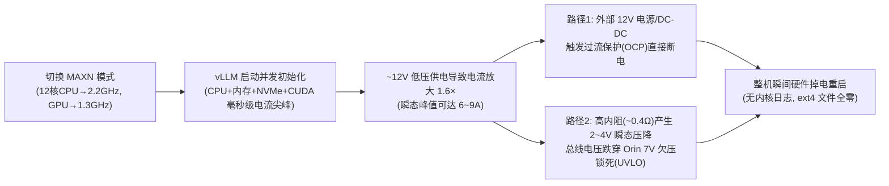

# Jetson AGX Orin `MAXN` 无限制功耗断电问题诊断报告

> 诊断对象：Jetson AGX Orin 64GB（`p3701-0005`）运行 `lightnav-serve`（`vllm_local`）  
> 结论摘要：**不是 LightNav-0 代码 Bug，极高概率是当前「~12V 高内阻供电链路」扛不住 `MAXN` 模式下的瞬时电流尖峰，触发硬件过流保护（OCP）或欠压复位（UVLO）。**

---

## 一、故障现象与已排除的嫌疑

本机在 `/etc/nvpmodel.conf` 中定义了 4 个功耗档位，实测表现差异非常清晰：

| 功耗模式（`nvpmodel -m`） | CPU 核心与频率上限 | GPU 频率上限 | 内存控制器（EMC） | 加载 9.7GB 模型 | 推理吞吐 |
|---|---|---|---|---|---|
| `MODE_15W` (`1`) | 4 核 ≤ 1.11 GHz | 408 MHz | 2133 MHz | 预期可用 | — |
| `MODE_30W` (`2`) | 8 核 ≤ 1.73 GHz | 612 MHz（半数 TPC） | 无限制（3199 MHz） | ✅ 稳定 | ~1.28 Hz |
| **`MODE_50W` (`3`)** | **12 核 ≤ 1.50 GHz** | **816 MHz（全 TPC）** | **无限制（3199 MHz）** | ✅ **稳定** | **1.50–1.56 Hz** |
| **`MAXN` (`0`)** | **12 核 ≤ 2.20 GHz** | **1300 MHz（全 TPC）** | **无限制（3199 MHz）** | ❌ **约 10–15 秒内瞬间断电重启** | — |

通过系统配置、历史日志和对照实验，可以**明确排除**以下常见软件/散热原因：

- **排除过热保护**：断电前 SoC 温度仅 41–45 °C，远低于 99 °C 降频/关机线。
- **排除内存耗尽（OOM）与软件异常**：64GB 统一内存充裕，日志无 Python traceback；同等权重在 `MODE_50W` 下稳定占 ~11 GB 内存。
- **排除 Linux 内核 Panic**：本机 `kernel.panic=0`，内核崩溃会死机卡死而不会立刻重启；实际表现为瞬间掉电重启。
- **物理掉电的直接铁证**：多次 `MAXN` 断电时留下的 `logs/power_maxn.log`、`logs/power_maxn2.log`、`logs/maxn311b.log` 全部损坏为 **4096 字节全 `0x00`**——这是 ext4 文件系统遭遇突然物理断电（缓存未刷盘，重启回放日志补零）的典型特征。
- **排除 LightNav-0 业务逻辑错误**：同一套代码和权重在 `MODE_50W` / `MODE_30W` 下运行完全正常。

---

## 二、关键调查突破：为什么之前陷入僵局，真相藏在哪里？

此前（2026-11-06）排查时曾陷入一个反直觉的谜团：用 `scripts/monitor_power.sh` 抓到 `MAXN` 断电前最后读数只有 **2.1–3.8 W、GPU 306 MHz（未升频）**，因而一度推翻了“供电不足”的猜测。

本次深度排查本机硬件传感器（`ina3221`）与 `logs/power50w.log`（3384 条历史采样）后，发现了**三个决定性证据**，彻底解开了这个矛盾：

### 证据 1：旧监控脚本读错了电源通道，完全漏掉了 CPU 功耗！

`scripts/monitor_power.sh` 读取的是 `ina3221/1-0040` 的通道 1（`in1_input` / `curr1_input`），并在输出里误标成了 `VDD_IN`（整板输入）。但本机硬件节点 `in*_label` 实际定义如下：

| INA3221 通道（`1-0040`） | 实际物理含义 | 本机空载读数 | 旧脚本是否监控 |
|---|---|---|---|
| `ch1` (`in1` / `curr1`) | **`VDD_GPU_SOC`**（仅 GPU 与 SoC） | 11.79 V / 0.22 A | ✅ 仅监控了这一路 |
| **`ch2` (`in2` / `curr2`)** | **`VDD_CPU_CV`**（**全部 12 核 CPU + CV**） | 11.79 V / 0.04 A | ❌ **完全未监控！** |
| **`ch3` (`in3` / `curr3`)** | **`VIN_SYS_5V0`**（5V 系统轨：NVMe/USB/底板） | 5.04 V / 0.82 A | ❌ **完全未监控！** |
| `ch4` (`curr4`) | `ch1 + ch2` 硬件求和（告警阈值 `5520 mA`） | 0.24 A | ❌ 未监控 |

**关键点**：`MAXN` 断电发生在 vLLM 刚初始化完模型结构、还没启动大量 GPU 算子的十几秒内。此时 GPU 还在 306 MHz，所以只看 `VDD_GPU_SOC` 当然只有 2–3 W；但同一时刻 **12 个 CPU 核心在 `MAXN` 下飙到 2.20 GHz**（相比 `MODE_50W` 的 1.50 GHz 暴涨 +47% 频率，动态功耗剧增），叠加 NVMe 与内存初始化的瞬时电流全发生在未监控的 `ch2` 和 `ch3` 上！

### 证据 2：传感器默认 512 ms 平均窗口吞掉了毫秒级尖峰

本机 `ina3221` 硬件配置为 `update_interval = 1 ms`、`samples = 512`，即系统读出的每个数字都是 **512 ms 内的平均值**。任何持续几毫秒到几十毫秒的高电流冲击都会被严重拉平，无法从日志看到真实峰值。

### 证据 3（最致命）：本机采用 ~12V 供电，且实测带载压降异常严重！

1. **本机不是 19V 供电，而是 ~12V 供电**  
   检查 `/sys/class/power_supply/ucsi-*` 均为离线（非 Type-C PD），主供电口电压空载为 **11.83–11.86 V**（推测接在 M1 机器狗的 12V 外设供电口或 12V DC 电源上，而非官方标配的 **19V / 4.74A = 90W** 适配器）。  
   按 $I = P / V$ 计算：**同样输出功率下，12V 所需电流是 19V 的 1.6 倍**。根据 NVIDIA 官方规格，AGX Orin 64GB 在 20V 下峰值电流可达 5.4A，换算到 **12V 时瞬时峰值电流可达 ~9A**！
2. **`MODE_50W` 下就已经出现近 1V 的剧烈压降**  
   统计 `logs/power50w.log` 的全部 3384 条数据：
   - 空载（`I_gpu ≈ 0.19 A`，`P_gpu ≈ 2.2 W`）：输入电压 **11.83 V**；
   - `MODE_50W` 推理峰值（仅 GPU 通道 `I_gpu = 2.30 A`，`P_gpu = 25.1 W`）：输入电压暴跌至 **10.92 V**！
   - **仅增加约 2.1 A 的电流，总线电压就跌了整整 0.91 V！** 这意味着整条供电链路（12V 电源模块 + 供电线 + 接插件）的等效串联阻抗高达 **$R_{\text{eff}} \approx 0.35\text{–}0.43\ \Omega$**（优质 19V 供电链路在同等电流下压降通常 < 0.2 V）。

---

## 三、断电机理与责任归属



- **为什么纯 `transformers` 加载脚本（`test_hf_load.py`）在 MAXN 下没死，而 vLLM 死了？**  
  因为 `test_hf_load.py` 是单线程顺序读权重再逐层搬运，电流曲线平缓；而 vLLM 在初始化阶段会并行拉起多线程、构建张量、分配大块显存与 CUDA 上下文，瞬间电流斜率（$di/dt$）和 CPU+GPU 叠加峰值远高于前者。
- **为什么板载 INA3221 的硬件过流降频（`OC3`，`curr4_crit = 5520 mA`）没救下来？**  
  `OC3` 是用来给 SoC 降频保命的，前提是外部电源本身稳得住。如果外部 12V 电源先触发 OCP 切断输出，或高内阻压降在微秒/毫秒级直接把电压拉穿硬件复位线，板载降频根本来不及介入。
- **结论归属**：这是 **供电系统硬件瓶颈**（大概率）与 **MAXN 无限制并发峰值** 叠加引发的问题，不是 LightNav-0 代码缺陷。仅保留极小概率是“单块 Orin 主板在 1.3 GHz / 2.2 GHz 最高电压档位本身不稳”——通过下方第一个验证步骤即可 100% 区分。

---

## 四、能修好吗？开启 MAXN 到底能提速多少？

### 1. 先建立理性预期：提速有限，但有价值

在 `MODE_50W` 下，单步延迟中位数为 **~642 ms（~1.52 Hz）**，其中视觉塔 ViT 占 ~130 ms，LLM 解码 5 个 token 占 ~523 ms。
- 大模型自回归解码（LLM decode）主要是 **内存带宽受限**（每生成一个 token 都要扫一遍约 9.7 GB 权重），而 `MODE_50W` 的内存控制器（EMC）**已经运行在满频 3199 MHz**。
- 因此，即便顺利跑上 `MAXN`（GPU 816 → 1300 MHz，+59%），端到端推理速度**不会翻倍或同步涨 59%**，预计提升幅度在 **15%–30% 左右**（约从 **1.5 Hz 提升到 ~1.8–2.0 Hz**，ViT 与预填充阶段收益更明显）。
- 如果未来需要逼近训练时的 **4 Hz** 体验，光靠调功耗模式达不到，仍需结合模型量化/精简或局域网 GPU 服务器远程推理（见 [M1_ROADMAP.md](../M1_ROADMAP.md) Phase 4）。

### 2. 解决方案与排查建议（按推荐优先级）

#### 方案 A：一锤定音验证 + 供电硬件治本（推荐，真正解决 MAXN）

1. **5 分钟桌面定位实验**：  
   先断开 12V 电源，换用 **NVIDIA 原装 19V / 4.74A（90W）DC 适配器**（或支持 20V / 5A 100W 的 PD 充电头）直接给 Orin 供电，再测试 `MAXN` 下启动 `lightnav-serve`。
   - **如果稳住不重启** → **100% 确认是当前 12V 供电链路问题**，Orin 主板本身完全健康。
   - **如果 19V/90W 依然断电** → 转向下方方案 C，重点排查主板固件/最高频档稳定性。
2. **机器狗上机供电改造（治本）**：  
   不要继续从高内阻 12V 细线给 AGX Orin 供 `MAXN` 满载电。查阅 M1 SDK 协议文档，机器狗机载还提供 **24V 外设电源口**（注意：**严禁 24V 直连 Orin**，Orin 上限为 20V！）。推荐方案：
   - 从机载 **24V（或 48V）主干口** 经一颗 **足功率稳压 DC-DC 降压模块（输出 19V，额定 ≥ 8A / 150W）** 供电给 Orin；
   - 缩短直流供电线并加粗线径（建议 ≥ 14–16 AWG 硅胶线），使用低接触电阻接头（如 XT60）。
   - 电压从 12V 升至 19V 后，同功率电流直降 **37%**，线路压降与发热损耗（$I^2R$）可降低 **60%**，彻底消除电压跌落风险。

#### 方案 B：不改硬件的软件折中提速（自定义中间档位）

如果短期内不便改动机器狗供电，但想在现有 12V 电源上比 `MODE_50W` 榨出更多推理效率，核心思路是 **“锁住 CPU 控峰值，适度放开 GPU 提推理”**：

1. **在 `/etc/nvpmodel.conf` 中新增自定义档位**（例如基于 `MODE_50W` 复制为 `ID=4`）：
   - 保持 12 核 CPU 上限在 **1.50 GHz**（甚至更低如 1.34 GHz），避免加载阶段 CPU 飙到 2.2 GHz 制造电流尖峰；
   - 将 `GPU MAX_FREQ` 从 `816000000`（816 MHz）按步进试探性上调至 **`918000000` → `1020000000` → `1122000000`**（避开最激进的 1300 MHz）。
2. **用全通道监控确认安全裕度**：  
   排查时不要再用旧的 `monitor_power.sh` 只看 `ch1`，应同时监控 `VDD_GPU_SOC`（`ch1`）、`VDD_CPU_CV`（`ch2`）、`VIN_SYS_5V0`（`ch3`）和输入电压最低值（并将 `samples` 调小到 `16` 以看清瞬态峰值）：
   ```bash
   # 临时缩小 INA3221 平均窗口到 16ms，并在单行内查看全通道电压与电流
   sudo sh -c 'echo 16 > /sys/bus/i2c/drivers/ina3221/1-0040/hwmon/hwmon1/samples'
   watch -n 0.2 '
     H=/sys/bus/i2c/drivers/ina3221/1-0040/hwmon/hwmon1
     echo "GPU_SOC: $(cat $H/in1_input)mV $(cat $H/curr1_input)mA | CPU_CV: $(cat $H/in2_input)mV $(cat $H/curr2_input)mA | 5V: $(cat $H/in3_input)mV $(cat $H/curr3_input)mA | SUM: $(cat $H/curr4_input)mA"
   '
   ```
   **安全红线参考**：持续负载下输入电压尽量维持在 **> 10.5 V**、无断电重启，且 `/sys/class/hwmon/hwmon5/oc3_event_cnt` 不频繁增长。

#### 方案 C：若换用官方 19V/90W 电源后 `MAXN` 依然断电

若桌面直连 19V/90W 适配器仍复现秒断，则排除外部供电，需抓取硬件最后时刻的内核/PMIC 信息：
1. 查看持久化日志（本机 `journalctl --list-boots` 已开启持久记录）：重启后运行 `journalctl -k -b -1 --no-pager | tail -80`；
2. 连接 40-pin 排针串口（Pin 8 TX / Pin 10 RX / Pin 6 GND，115200 8N1）捕获断电瞬间未及落盘的内核或 PMIC 打印；
3. 检查是否为个别批次板卡在 1.3 GHz V/F 档位异常，通过自定义 `nvpmodel` 避开 1300 MHz（如锁定 1122/1224 MHz）规避。
